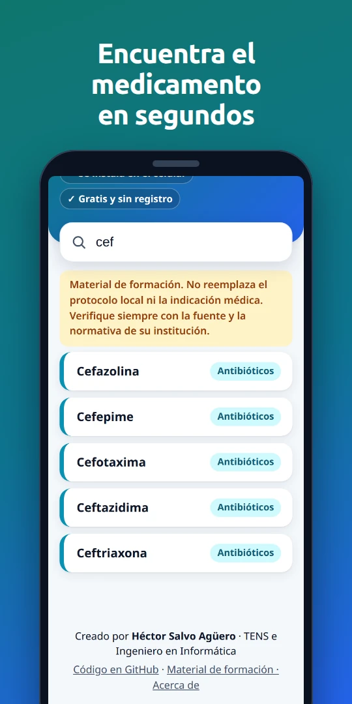
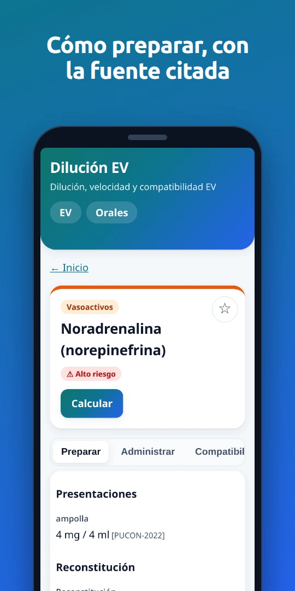
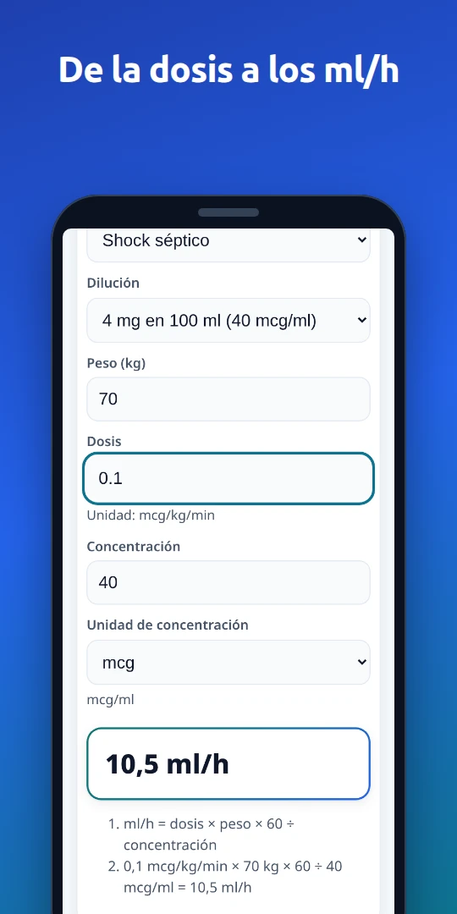
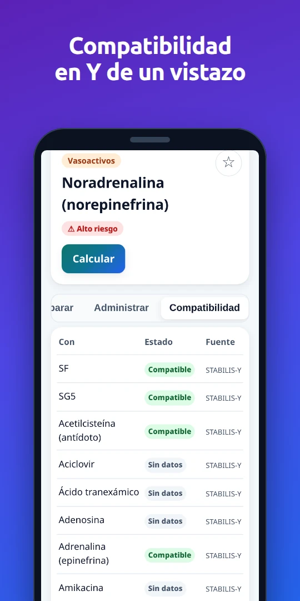
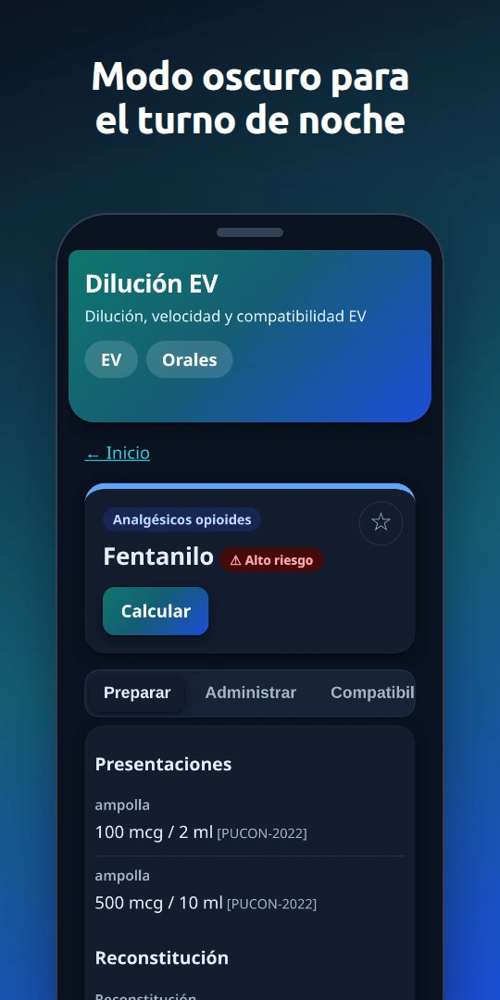

# Dilución EV

Aplicación web instalable (PWA) para **preparar y administrar medicamentos endovenosos usados en Chile**: presentaciones, dilución, velocidad de infusión, compatibilidad en Y, interacciones graves, efectos adversos y calculadoras de dosis (ml/h, gotas/min, dosis por peso y pediatría con tope).

**App publicada:** https://januch-6-6-6.github.io/dilucion-ev/ (se puede instalar en el celular y funciona sin internet).

> **Material de formación. No reemplaza el protocolo local ni la indicación médica. Verifique siempre con la fuente y la normativa de su institución.**

## Capturas

<p>
  
  
  
  
  
</p>

Son capturas reales de la app en un celular de 360 px, montadas en un marco de teléfono (estilo ficha de Google Play). También se muestran en la portada, en el carrusel «Así funciona».

## Qué la hace distinta

- **Cada dato clínico tiene fuente citada** (protocolo chileno, ficha técnica oficial, etiqueta FDA, Stabilis, Pediamécum) y la app muestra las discrepancias entre fuentes.
- **Las fórmulas están cubiertas por pruebas automáticas** con casos calculados a mano.
- **Un validador bloquea la publicación** si una ficha no tiene fuente, tiene rangos incoherentes o compatibilidad asimétrica.
- **Funciona sin internet** una vez abierta (útil en un móvil SAMU o en pabellón sin señal).

## Estado

Versión 0.2: 89 medicamentos en tres tandas — urgencia/prehospitalario (42), antibióticos, antivirales y antifúngicos (25) y hospitalarios (22) — con compatibilidad en Y para todos los pares (Stabilis).
Revisión clínica del autor aplicada el 2-oct-2026: decisiones documentadas en `informes/v0.2-decisiones-revision.md` y aplicadas en `scripts/fichas/revision.py`; discrepancias entre fuentes en `informes/v0.2-revision-clinica.md`. Las fichas **no están firmadas como validadas**: falta la validación de un químico farmacéutico antes de cualquier uso en terreno.

**Módulo Orales (APS) — rama `orales-v1`:** 79 medicamentos orales del arsenal de Atención Primaria de Salud chilena con calculadora pediátrica por peso/edad, dosis fija de adulto, conversión a presentaciones líquidas (jarabes y gotas) y cotejo de fuentes (CIMA y Pediamécum). En proceso de revisión clínica antes de publicación (`informes/orales-v1-revision-pendiente.md`).

## Desarrollo

```bash
npm install
npm run dev                  # servidor local
npm test                     # pruebas (cálculos, validador, pantallas y build PWA)
npm run validar              # valida medicamentos EV y fichas orales
python3 scripts/generar-orales.py  # regenera datos/orales/*.yaml y fuentes-orales.yaml
npm run build                # valida datos y compila
```

### Regenerar las capturas y la imagen Open Graph

Cuando cambie la interfaz, rehacer `public/capturas/*.webp` (540×1080, ≤ 120 KB, lo revisa una prueba) y `public/og.png` (1200×627):

```bash
npm run build
PLAYWRIGHT=/ruta/a/node_modules/playwright/index.mjs node scripts/capturas/generar-capturas.mjs
npm run build                # para que dist/ incluya las capturas nuevas
```

El script levanta `vite preview`, bloquea el contador de visitas, da por aceptado el aviso inicial y saca las pantallas con Chromium. Necesita ImageMagick (`magick`). Los titulares salen de `src/app/capturas.ts`.

### Agregar un medicamento

1. Registrar las fuentes en `datos/fuentes.yaml`.
2. Crear `datos/medicamentos/<id>.yaml` con la estructura de `src/esquema/ficha.ts`; cada número con unidad y `fuente: { ref, detalle }`.
3. `npm run validar` hasta que no haya errores.

## Autor

Héctor Salvo Agüero — Técnico en Enfermería (13 años en urgencias, SAMU y pabellón) e Ingeniero en Informática.
